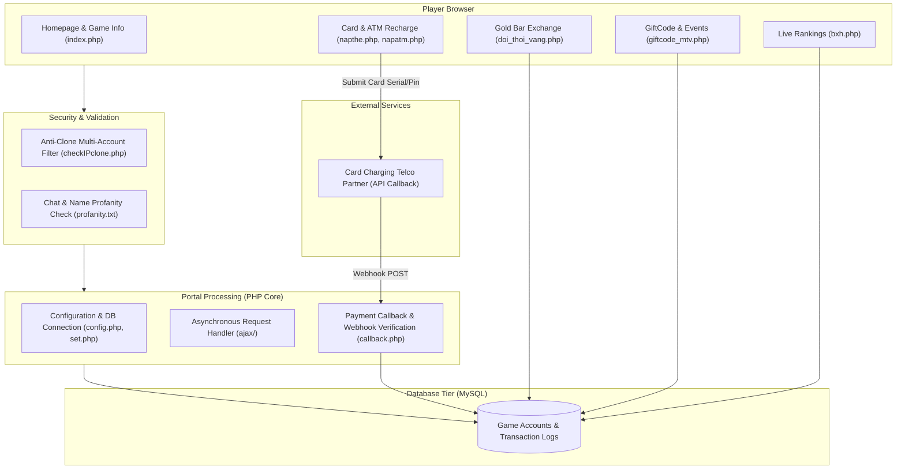

# Ngọc Rồng Online (NRO) — Community Web Portal & Card Billing Gateway (Gốc)

[](https://www.php.net/)
[](https://www.mysql.com/)
[](https://developer.mozilla.org/en-US/docs/Web/JavaScript)
[](https://developer.mozilla.org/en-US/docs/Web/CSS)

> A lightweight, responsive web portal, automated scratch card billing gateway, and community engagement hub for **Ngọc Rồng Online (Dragon Boy)** private game servers.

---

## 1. System Architecture



---

## 2. Key Modules & Features

* **Automated Card & ATM Billing**:
  * Seamless scratch card redemption (`napthe.php`) with asynchronous verification via external telco API webhooks (`callback.php`).
  * In-game currency (`Vàng`, `Ngọc`) instantly credited to player game accounts with comprehensive transaction logging (`lich-su-nap.php`).
* **Gold Bar Conversion System (`doi_thoi_vang.php`)**:
  * Exchange in-game currency into tradeable gold bars with transaction validation (`goldbar_callback.php`).
* **Giftcode & Event Management**:
  * Real-time giftcode redemption system (`giftcode_mtv.php`, `danhsach_gift.php`).
  * Social share event tracking (`su_kien_share.php`) rewarding players for viral promotions.
* **Security & Anti-Abuse**:
  * IP cloning detection (`checkIPclone.php`) limiting automated multi-account farming.
  * Keyword profanity filtering (`profanity.txt`) to protect community discussions.
* **Sprite & Game Asset Showcase**:
  * Embedded animation sprites (`animation/`), item icons (`item/`), and character previews extracted directly from game assets.

---

## 3. Tech Stack

| Domain | Technology |
| :--- | :--- |
| **Backend** | PHP 7.4+ / 8.x |
| **Database** | MySQL / MariaDB (PDO / MySQLi) |
| **Frontend** | HTML5, CSS3, JavaScript, jQuery / AJAX |
| **Web Server** | Apache (URL rewriting via `.htaccess`) |

---

## 4. Getting Started

### Prerequisites
- PHP 7.4+ with `curl`, `pdo_mysql`, `json` extensions
- MySQL 5.7+ / MariaDB 10.4+
- Web server (Apache, Nginx, or XAMPP)

### Setup Instructions
1. Clone the repository into your web directory:
   ```bash
   git clone https://github.com/btoan2802/web_nro_goc.git
   ```
2. Copy the sample configuration:
   ```bash
   cp cauhinh.example.php config.php
   ```
3. Edit `config.php` and configure:
   - MySQL host, database name, user, and password.
   - Telco charging partner API ID and Secret Key.
4. Access the web portal at `http://localhost/web_nro_goc`.

---

## 5. Author & License

- **Author**: Nguyễn Bảo Toàn ([@btoan2802](https://github.com/btoan2802))
- **License**: Educational / Proprietary
